# Text Summarization Tool


[](LICENSE)

**Big ideas. Fewer words.**

A complete Flask application for turning lengthy English articles, research notes,
and everyday reading into concise summaries. Presented as **Briefly**, a calm,
modern reading workspace, it pairs Hugging Face NLP with authentication, private
summary history, and a dedicated administration suite.

Built for the GitHub portfolio of **AliAdilQ**.
[Explore the repository](https://github.com/AliAdilQ/Text_Summarization_Tool).

## Project overview

Paste a passage, choose how much detail you need, and get a summary with word
counts, text reduction, and processing time. Guest users can try the tool without
creating an account. Registered users automatically build a searchable personal
library. Administrators can manage users, inspect saved summaries, and monitor
activity through Chart.js analytics.

The app starts without model downloads. When cached DistilBART weights are
available, it generates abstractive summaries; otherwise a lightweight extractive
engine keeps the entire workflow usable. Every result identifies the engine used.

## Key features

- **Summarization:** three lengths, live Unicode-aware word and character counts,
  example text, input validation, loading feedback, copy, and `.txt` downloads.
- **NLP service:** lazy Hugging Face pipeline loading, token-aware chunking,
  hierarchical reduction, bounded processing passes, and graceful offline fallback.
- **Accounts:** registration, username/email sign-in, Werkzeug password hashing,
  remembered sessions, editable profiles, and account deactivation.
- **Private history:** searchable, filtered, paginated history; original/summary
  comparisons; individual deletion; and confirmed history clearing.
- **Admin suite:** a separate sidebar layout, user search/details, safe role and
  status changes, account deletion, summary search/filters/details, and deletion.
- **Analytics:** total users and summaries, today's summary count, average
  reduction and latency, seven-day activity, length distribution, and active users.
- **Design:** local typography, custom Bootstrap styling, Bootstrap Icons,
  responsive layouts, accessible feedback, empty states, and persistent dark mode.
- **Developer experience:** application factory, blueprints, reusable models/forms,
  idempotent seeding, automated tests, CI, and a real-browser screenshot script.

## Screenshots

Real screenshots captured from the running, seeded application. The summary
result shown uses the offline extractive engine. See
[capture details and all views](docs/screenshots/README.md).

### Home page

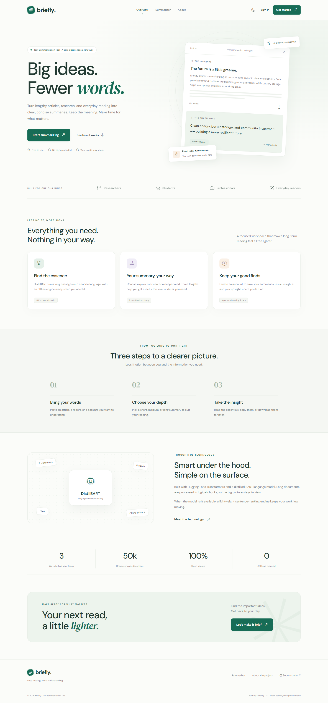

### Text summarization

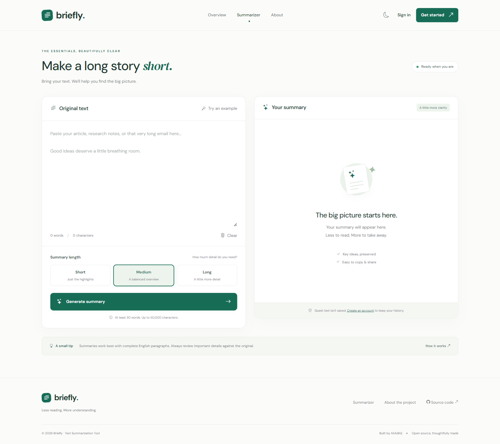

### Summary result


### Abstractive model result

The same workspace using the downloaded DistilBART model:

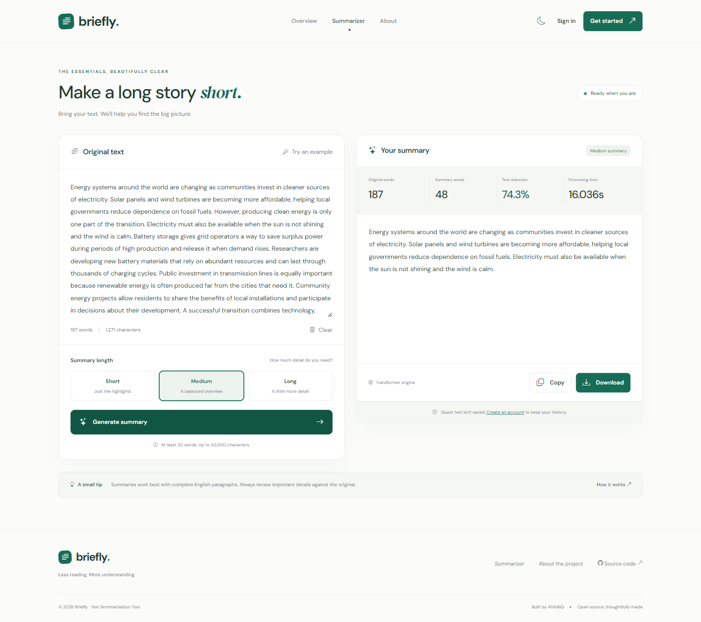

### Personal workspace

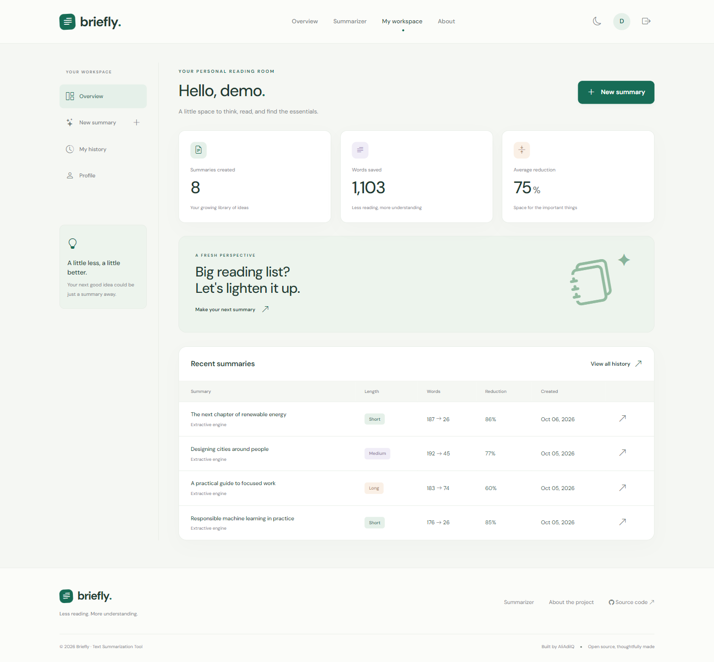

### Reading history

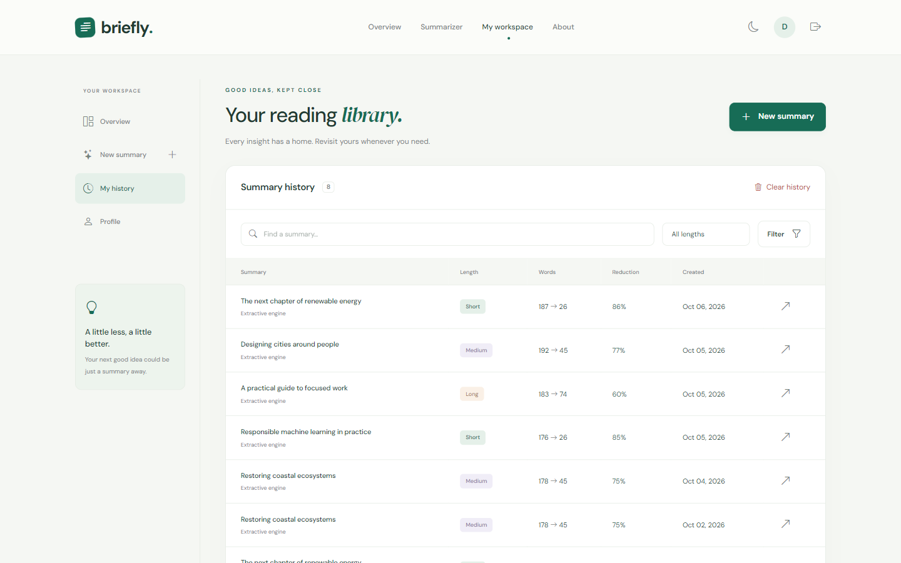

### Admin dashboard

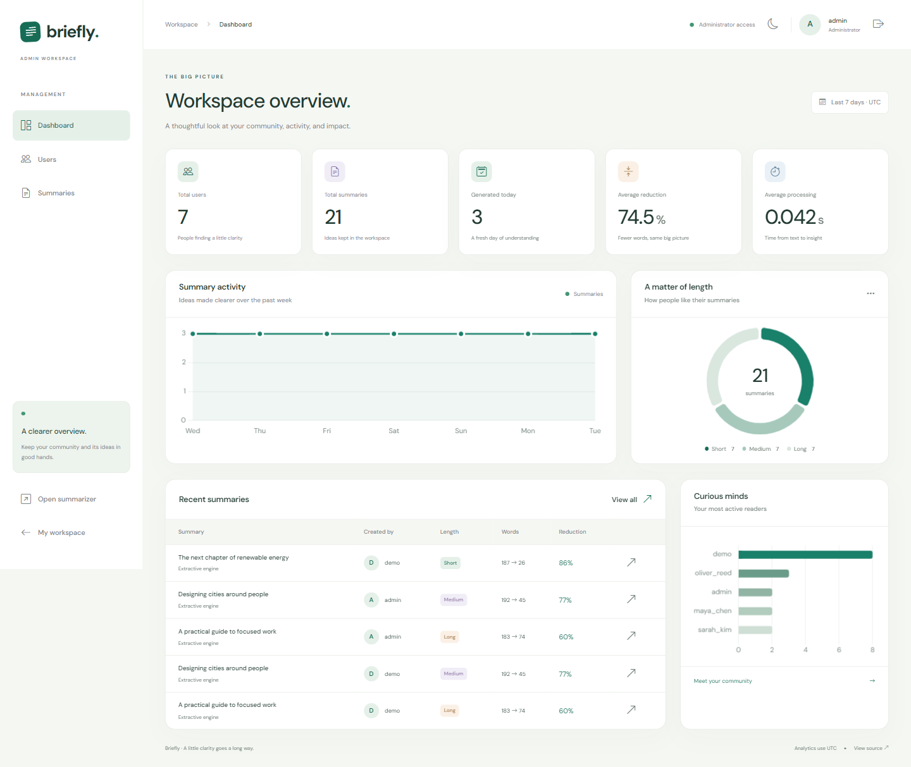

### User management

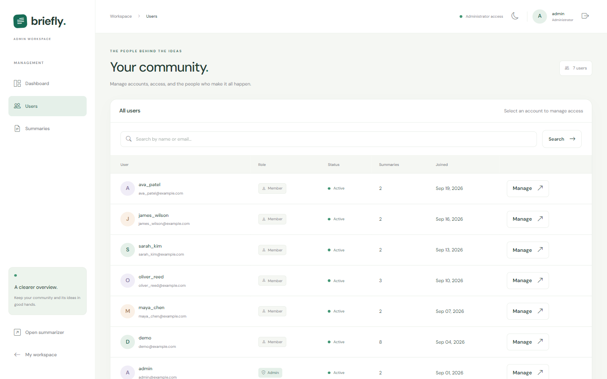

### Summary management

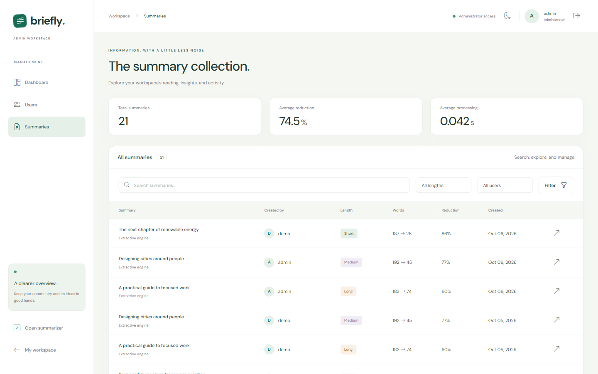

### Dark mode

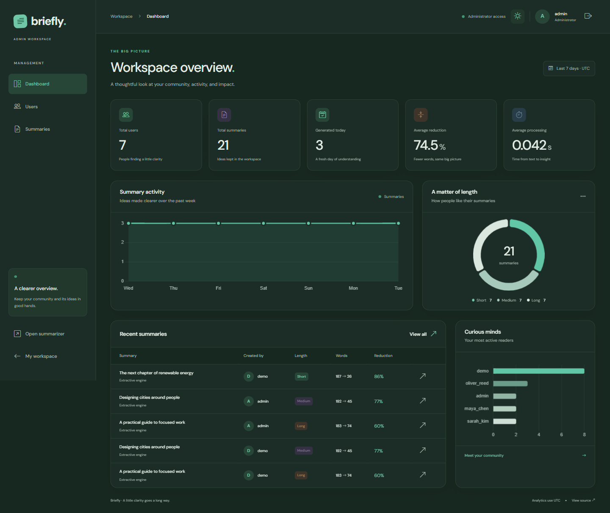

<details>
<summary>Sign-in page and mobile layout</summary>

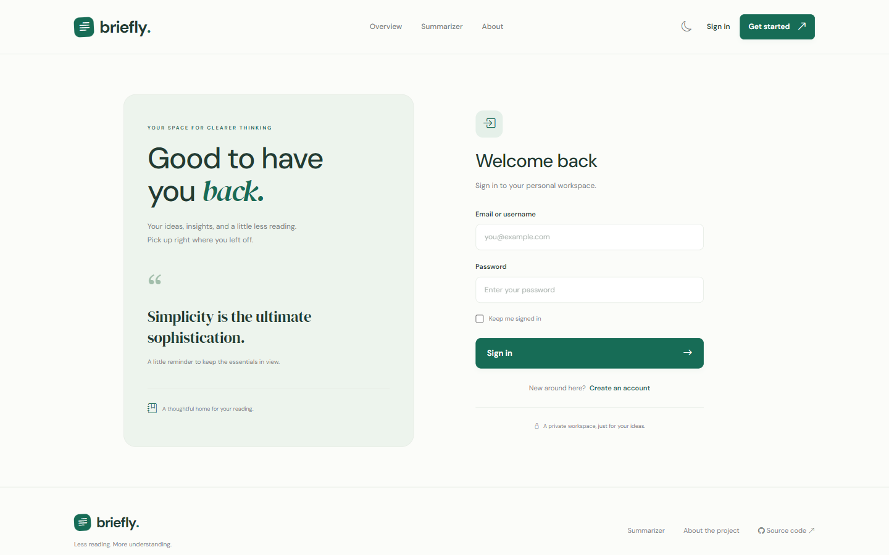

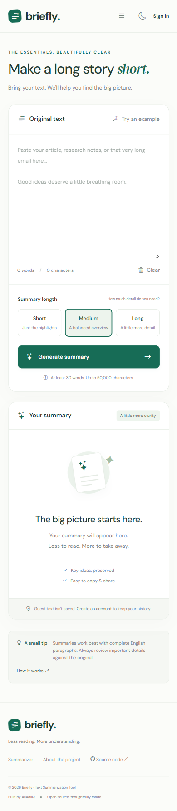

</details>

## Technology stack

| Layer | Technologies |
| --- | --- |
| Backend | Python 3.10+, Flask 3.1, modular blueprints |
| Database | SQLite, Flask-SQLAlchemy, SQLAlchemy |
| Authentication | Flask-Login, Werkzeug password hashing |
| Forms/security | Flask-WTF, WTForms, email-validator, CSRF protection |
| NLP | Hugging Face Transformers 4.x, PyTorch, DistilBART |
| Frontend | HTML5, custom CSS, Bootstrap 5.3, vanilla JavaScript |
| Icons/analytics | Bootstrap Icons 1.11, Chart.js 4.4 |
| Typography | Locally served DM Sans and DM Serif Display |
| Runtime | python-dotenv; Waitress for production serving |
| Verification | pytest, Ruff, Playwright, djLint |

There is no React build step, paid inference API, or required API key. Frontend
libraries and fonts are bundled locally with their license notices.

## Project architecture

`create_app()` initializes configuration and extensions, registers five
blueprints, installs error handlers, and creates missing database tables. Route
handlers validate input and orchestrate services; the NLP implementation lives
in `app/services/summarizer.py` rather than in a route.

`User` and `Summary` are SQLAlchemy models. Personal-history routes query both
the summary ID and the signed-in user ID. Administrative routes use a shared
authorization decorator and a separate layout. Flask-WTF protects all mutations,
including the JSON endpoint through its `X-CSRFToken` header.

## NLP model explanation

The default abstractive model is
[`sshleifer/distilbart-cnn-12-6`](https://huggingface.co/sshleifer/distilbart-cnn-12-6),
a distilled BART checkpoint intended for English news summarization. It has
approximately 306 million parameters and uses a 1,024-token input context.

The application uses the Hugging Face **summarization pipeline**. The model's
documentation specifies that this pipeline is supported in Transformers 4.x;
`requirements.txt` therefore constrains Transformers below version 5.
Weights are cached by Hugging Face outside the repository. They are not committed.

Model loading is lazy and happens once per worker. By default, only locally cached
weights are loaded. A failed load is remembered until the process restarts, so
each request does not repeat an unsuccessful download or initialization.

## How summarization works

1. Validate the length selection and text: **30 words minimum**, **50,000
   characters maximum**. Request bodies are also capped at 200,000 bytes.
2. Compute token budgets from the tokenizer and model configuration, leaving room
   for special tokens.
3. Split at sentence/paragraph boundaries. Split an oversized sentence by token
   IDs so an unusually long sentence also fits the model context.
4. Summarize each chunk using deterministic beam search. Short, medium, and long
   settings have different generation bounds.
5. Combine chunk summaries and summarize again when needed. Reduction is bounded
   to four passes; a sentence-ranking finish is used if the model does not shrink
   the combined result sufficiently. Such results are labeled **hybrid**.
6. If model loading or inference fails, rank source sentences by meaningful word
   frequency, select within a length-specific word budget, and restore source
   order. This fallback needs no model, network, NLTK corpus, or API key.
7. Return the summary and metrics. If signed in, save it to the user's history.
   Database-save failures preserve the generated result and show a save warning.

Text reduction is calculated as
`(1 − summary_words / original_words) × 100`. Processing time covers the NLP
operation, including initial model loading when applicable, rather than the
network round trip or database write.

Summarization does not fact-check documents. The news-trained model may lose
context or generate inaccurate details, particularly outside its training domain.
Review important material against the original.

## Installation

Install **Python 3.10 or newer** and Git, then clone the repository:

```bash
git clone https://github.com/AliAdilQ/Text_Summarization_Tool.git
cd Text_Summarization_Tool
```

### Virtual environment setup

Windows PowerShell:

```powershell
python -m venv venv
.\venv\Scripts\Activate.ps1
```

Windows Command Prompt:

```bat
python -m venv venv
venv\Scripts\activate.bat
```

Linux/macOS:

```bash
python3 -m venv venv
source venv/bin/activate
```

### Requirements installation

```bash
python -m pip install --upgrade pip
pip install -r requirements.txt
```

PyTorch is a substantial dependency. If you only need the offline extractive
engine on a constrained machine, install `requirements-core.txt` instead and set
`SUMMARIZER_BACKEND=extractive`. The full requirements support both engines.

## Environment configuration

Windows PowerShell:

```powershell
Copy-Item .env.example .env
```

Linux/macOS:

```bash
cp .env.example .env
```

The development configuration is ready to use without editing `.env`. A random
development secret is generated in the ignored `instance/` directory and reused
across restarts. Production requires an independently configured `SECRET_KEY`.

| Variable | Default | Purpose |
| --- | --- | --- |
| `SECRET_KEY` | Generated locally in development | Signs sessions and CSRF tokens; mandatory in production |
| `FLASK_ENV` | `development` | App configuration mode; `production` prevents demo seeding |
| `DATABASE_URL` | `sqlite:///text_summarizer.db` | SQLAlchemy database URL; relative SQLite paths resolve inside `instance/` |
| `HOST` / `PORT` | `127.0.0.1` / `5000` | Development server address |
| `SUMMARIZER_BACKEND` | `auto` | `auto`, `transformer`, or `extractive`; model failures fall back in all model modes |
| `MODEL_NAME` | `sshleifer/distilbart-cnn-12-6` | Compatible summarization checkpoint |
| `MODEL_ALLOW_DOWNLOAD` | `false` | Permit network model loading during requests; explicit predownload is preferred |
| `SESSION_COOKIE_SECURE` | `false` | Use `true` for an HTTPS deployment; also controls remembered-login cookies |

`FLASK_ENV` is read by this project's configuration. Debug mode is disabled in
`run.py`; use `flask --app run run --debug` only for local debugging.

## Database initialization

The application automatically creates `instance/text_summarizer.db` and missing
tables on startup. To initialize them explicitly:

```bash
flask --app run init-db
```

No manual SQL editing is required. `create_all()` does not migrate an existing
schema; use proper migrations before applying schema changes to a deployed system.

## Database seeding

```bash
python seed.py
```

Or use `flask --app run seed`. The seed creates **seven users** (one administrator,
one demo user, five fictional members) and **21 realistic summaries** about clean
energy, urban design, focused work, responsible ML, coastal ecosystems, and
learning. Summary lengths and timestamps vary to populate analytics.

Unique seed keys prevent duplication on repeated runs. Existing account passwords,
roles, and profiles are preserved. Additional fictional users receive random
passwords, not shared login credentials. Seeding is disabled in production.

The database, development secret, virtual environment, and model caches are
ignored. Each clone recreates its own local demonstration data.

## Running the project

```bash
python run.py
```

Open [http://127.0.0.1:5000](http://127.0.0.1:5000).

A complete Windows quick start after cloning:

```powershell
python -m venv venv
.\venv\Scripts\Activate.ps1
pip install -r requirements.txt
Copy-Item .env.example .env
python seed.py
python run.py
```

A complete Linux/macOS quick start after cloning:

```bash
python3 -m venv venv
source venv/bin/activate
pip install -r requirements.txt
cp .env.example .env
python seed.py
python run.py
```

### Enable abstractive summarization

Download and validate the model once:

```bash
flask --app run download-model
```

Then restart the server. With `SUMMARIZER_BACKEND=auto`, cached model weights are
used automatically. The first model download requires internet access and roughly
1.2 GB for the weights, with additional disk space and several GB of available
RAM recommended. CPU inference can take substantially longer than the extractive
engine, especially for long inputs.

To force a fast offline engine, set `SUMMARIZER_BACKEND=extractive` in `.env`.
Model-download and inference failures never intentionally disable the application.

## Demo accounts

### Administrator

- Username: `admin`
- Email: `admin@example.com`
- Password: `Admin123!`

### Demo user

- Username: `demo`
- Email: `demo@example.com`
- Password: `Demo123!`

**These credentials are provided solely for local demonstration and testing.
Change or remove them before any real deployment.** They are stored as password
hashes, never as plaintext database values. They only exist after seeding.

## Admin dashboard information

Sign in with the seeded administrator to open `/admin`. Analytics are calculated
from the actual database; timestamps and daily buckets use **UTC**.

- **Dashboard:** user/summary counts, summaries generated today, average text
  reduction, processing time, recent activity, length distribution, and most
  active readers.
- **Users:** search username/email, inspect account dates and activity, promote or
  demote other users, activate/deactivate accounts, and delete normal users.
- **Summaries:** search saved content, filter by length/owner, paginate, compare
  original text and output, download, and delete.

Admins cannot demote, deactivate, or delete their own account through this panel.
An administrator must be demoted before being deleted, and the application guards
against removal of the last active administrator. Account deletion also deletes
that user's summaries. Destructive actions require a confirmation dialog and CSRF.

## Usage guide

1. Open **Summarizer** or select **Start summarizing** on the home page.
2. Paste complete English prose, or try the built-in renewable-energy example.
3. Choose **Short**, **Medium**, or **Long**, then generate a summary.
4. Review the summary, metrics, and engine notice. Copy or download the result.
5. Create an account or sign in to save subsequent summaries automatically.
6. Open **My workspace → My history** to search, filter, revisit, or remove items.
7. Use the moon/sun control to switch themes. Your browser remembers the setting.

Guest inputs are not saved. Signed-in original texts and summaries are stored in
SQLite and visible only to their owner and authorized administrators. Other normal
users cannot read, download, or delete them.

## Tests

Install development dependencies and run the suite:

```bash
pip install -r requirements-dev.txt
python -m pytest
ruff check .
```

For a lightweight test environment without model packages:

```bash
pip install -r requirements-core.txt pytest ruff
python -m pytest
```

Tests use isolated in-memory databases and the extractive engine. Transformer
loading, inference errors, token budgets, and multi-pass reduction are mocked;
tests do not download model weights. Coverage includes public pages, registration,
password hashing, login/logout, safe redirects, deactivated sessions, protected
routes, profile editing, summary validation/storage/downloads/deletion, cross-user
privacy, admin safeguards and filters, CSRF, escaped content, seeding, security
headers, and error responses.

GitHub Actions runs lightweight checks on Python 3.10 and 3.12.
[The verification record](docs/verification.md) includes local test, browser,
and real-model validation.
[Deployment considerations](docs/deployment.md) describe readiness limits.

### Real browser verification and screenshots

Start the seeded local app in one terminal. In another terminal:

```bash
pip install playwright
python -m playwright install chromium
python scripts/capture_screenshots.py
```

The optional script captures a 1440×900 desktop viewport, checks critical UI
flows and narrow-screen overflow, and verifies dark-mode persistence. It signs
in with local demo accounts and creates/deletes a temporary test account through
the real registration/admin interfaces. Run it only against a local demo instance.
Normal app usage does not require Playwright or a browser installation.

For an existing Chromium browser, pass
`--browser-executable "/path/to/chrome"`. To use a different local port, pass
`--base-url http://127.0.0.1:5001`.

## API and route overview

| Method | Route | Access / purpose |
| --- | --- | --- |
| GET | `/`, `/about`, `/summarizer` | Public pages |
| GET/POST | `/register`, `/login` | Account forms |
| POST | `/logout` | Authenticated sign-out with CSRF |
| POST | `/api/summarize` | Guest or signed-in summarization with CSRF |
| GET | `/workspace` | Personal dashboard |
| GET | `/workspace/history` | Own history; `q`, `length`, `page` filters |
| POST | `/workspace/history/clear` | Delete own history |
| GET/POST | `/workspace/profile` | View/edit own account |
| GET | `/workspace/summaries/<id>` | Own summary details |
| GET | `/workspace/summaries/<id>/download` | Own `.txt` download |
| POST | `/workspace/summaries/<id>/delete` | Delete own summary |
| GET | `/admin` | Admin analytics |
| GET | `/admin/users`, `/admin/users/<id>` | Admin user management |
| POST | `/admin/users/<id>/<action>` | `role`, `status`, or `delete` |
| GET | `/admin/summaries` | `q`, `length`, `user_id`, `page` filters |
| GET | `/admin/summaries/<id>` | Admin summary details |
| GET/POST | `/admin/summaries/<id>/download`, `…/delete` | Download (GET) / delete (POST) |
| GET | `/health` | Liveness JSON |

The JSON endpoint expects `{"text": "…", "length": "medium"}` and a same-session
`X-CSRFToken` header, obtained from the page's `csrf-token` meta tag. It is designed
for the web client, not an unauthenticated third-party integration API.

Example response fields include `summary`, `original_word_count`,
`summary_word_count`, `compression_ratio`, `processing_time`, `method`, `notice`,
and `saved`; authenticated successful saves also return `id` and `detail_url`.
Invalid text returns 422; malformed JSON or CSRF errors return 400.

## Folder structure

```text
Text_Summarization_Tool/
├── app/
│   ├── __init__.py             # Application factory, security, errors, CLI
│   ├── extensions.py           # SQLAlchemy, LoginManager, CSRF
│   ├── utils.py                # Authorization, redirects, downloads
│   ├── models/                 # User and Summary
│   ├── forms/                  # Authentication, profile, summarization
│   ├── routes/                 # main, auth, summarizer, user, admin
│   ├── services/               # NLP engine and idempotent seeding
│   ├── templates/              # Public, account, user, admin, error pages
│   └── static/
│       ├── css/style.css
│       ├── js/                 # Shared controls, summarizer, charts
│       ├── images/favicon.svg
│       └── vendor/             # Local libraries, fonts, license notices
├── instance/.gitkeep           # Runtime database/secret are ignored
├── docs/
│   ├── deployment.md
│   └── screenshots/            # Actual running-app screenshots
├── scripts/capture_screenshots.py
├── tests/                     # Isolated unit/integration tests
├── .github/workflows/tests.yml
├── config.py
├── run.py
├── seed.py
├── requirements.txt           # Full app + model dependencies
├── requirements-core.txt      # Lightweight offline application
├── requirements-dev.txt       # Tests/browser/formatting tools
├── pytest.ini
├── pyproject.toml
├── .env.example
├── .gitignore
├── CONTRIBUTING.md
├── LICENSE
└── README.md
```

## Security notes

- Werkzeug hashes passwords; the app never stores plaintext passwords.
- Flask-WTF validates CSRF for forms and the JSON summarization endpoint.
- History ownership is enforced server-side for reading, downloads, and deletion.
- Admin access is checked server-side for every admin route.
- Jinja escapes saved content; JavaScript renders generated text with `textContent`.
- Inputs are bounded, redirects remain local, and destructive actions require
  confirmation. Session cookies are HTTP-only and use `SameSite=Lax`.
- Development secrets and SQLite files are ignored. Production startup refuses
  a missing secret; demo seeding is disabled in production.
- Local static assets, basic security headers, and friendly error pages reduce
  external dependencies and avoid exposing tracebacks to visitors.

For public deployment, add HTTPS, rate limits, backups, operational monitoring,
and appropriate retention policies. The current app does not include email
verification, password reset, MFA, distributed throttling, or schema migrations.
Use a production WSGI server, not the Flask development server. See the complete
[deployment guide](docs/deployment.md).

## Future improvements

- Background summarization jobs, cancellation, and progress reporting.
- Document uploads with safe PDF/text extraction.
- Multilingual models and per-domain evaluation.
- Email verification, password recovery, and multifactor authentication.
- Database migrations, PostgreSQL support, and distributed rate limits.
- Configurable retention and exports for reading libraries.

## Contributing

Fork the repository, create a focused branch, make your changes, run the checks,
and open a pull request. See [CONTRIBUTING.md](CONTRIBUTING.md).

## License

Released under the [MIT License](LICENSE). Bundled third-party assets retain
their own [license notices](app/static/vendor/licenses/).

## Author

**AliAdilQ**

GitHub: [https://github.com/AliAdilQ](https://github.com/AliAdilQ)

Repository: [https://github.com/AliAdilQ/Text_Summarization_Tool](https://github.com/AliAdilQ/Text_Summarization_Tool)

## GitHub repository

[AliAdilQ/Text_Summarization_Tool](https://github.com/AliAdilQ/Text_Summarization_Tool)
